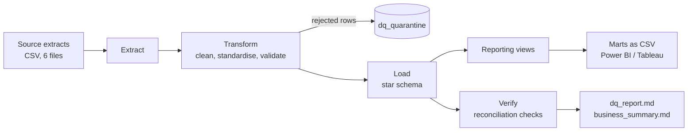
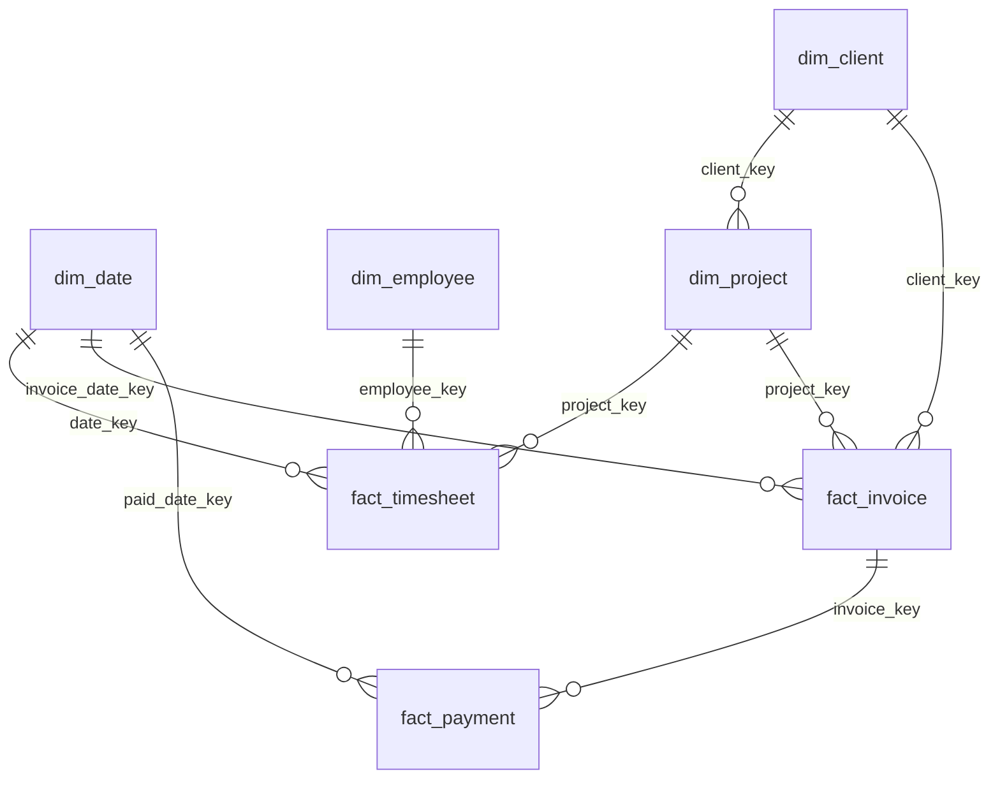

# Consulting Analytics Warehouse

An end-to-end data pipeline and reporting layer for a fictional consulting firm, built with Python and SQL. It takes messy exports from five source systems (HR, projects, timesheets, billing, bank receipts), cleans and validates them, loads a star schema, and answers the questions a practice leader asks: **Who is over or under utilized? Which projects lose money? Who owes us cash and how old is it? What work has not been billed?**

> All data is synthetic and generated by `etl/generate_source.py`. Defects (duplicates, blanks, bad dates, orphan keys, inconsistent codes) are injected on purpose so the pipeline has real cleaning work to do.

## What it demonstrates

| Skill | Where to look |
|---|---|
| ETL design: extract, clean, load, verify, publish | `etl/pipeline.py`, `etl/transform.py`, `etl/load.py` |
| Dimensional modelling, including a **slowly changing dimension (type 2)** | `sql/01_schema.sql`, `etl/transform.py::build_employee_versions` |
| Data profiling and a rule-based **data-quality framework** with a quarantine table | `etl/quality.py`, `output/dq_report.md` |
| Reconciliation: every source row is accounted for | `etl/checks.py` (rules R01 to R07) |
| Complex SQL: CTEs, window functions, views | `sql/02_views.sql`, `sql/03_analysis_queries.sql` |
| Stored procedures and functions (T-SQL and MySQL versions) | `sql/tsql/`, `sql/mysql/` |
| Automated tests and CI | `tests/test_pipeline.py`, `.github/workflows/ci.yml` |
| BI delivery: measures, model and page design for Power BI | `powerbi/` |
| Cloud mapping (design only) | `docs/azure_mapping.md` |

## Architecture





## Run it

Written and tested on Python 3.13. No packages to install: the project uses only the standard library, so any recent Python 3 should work.

```bash
python run_pipeline.py                      # build everything, about one second
python -m unittest discover -s tests -v     # 20 tests
```

Outputs land in `output/`: `warehouse.db` (SQLite star schema), `marts/` (CSVs for Power BI or Tableau), `dq_report.md`, `business_summary.md`, `run_summary.json`. The run exits with status 1 if any critical check fails, so it can gate a scheduled job.

## What a run does with the messy data

| Source table | Rows read | Duplicates removed | Quarantined | Loaded |
|---|---:|---:|---:|---:|
| clients | 32 | 2 | 0 | 30 |
| projects | 80 | 0 | 0 | 80 |
| timesheets | 21,266 | 252 | 513 | 20,501 |
| invoices | 594 | 6 | 2 | 586 |
| payments | 549 | 5 | 5 | 539 |

Rows read always equals duplicates removed plus quarantined plus loaded (rule R01). The full rule list, with counts per rule, is in `output/dq_report.md`.

## Example findings (from the synthetic data)

These come from `output/business_summary.md` and change if the data is regenerated with another seed.

- Utilization in 2026 is about 52%, from 61% in Risk Advisory down to 46% in Tax Technology.
- Delivery margin is about 56% (before overheads) and billing realizes about 90% of the value of work at standard rates.
- 26 of 80 projects have used more hours than budgeted.
- 44% of receivables are overdue. Three clients pay on average 62 to 70 days after the due date.
- About ₹2 crore of billable work has not yet been invoiced.

## Design decisions

- **Quarantine, do not drop.** A rejected row is kept with its rule id and full content, so a data owner can fix it at source.
- **SCD type 2 for employees.** A promotion closes the old row and opens a new one. Each timesheet line points at the version valid on the day, so history keeps the rate that applied then. Test: `test_scd2_rate_matches_date_of_work`.
- **Business logic lives in views,** not in the report, so Power BI, Tableau and ad hoc SQL all agree.
- **One reporting date** (`etl_config.as_of_date`) drives ageing, WIP and utilization, which makes every number reproducible.
- **Reconciliation gates.** The pipeline fails when row counts, invoice totals or standard value do not tie out.
- **A bug the tests caught during development:** the first version of the generator let one person log 20+ hours a day, giving 361% utilization in one month. The utilization range test failed, and the generator now caps a person's logged hours per day.

## Limits worth knowing

- SQLite is the tested engine. The T-SQL and MySQL objects in `sql/tsql` and `sql/mysql` mirror the logic of the SQLite views but have not been executed in this repository's test run.
- Power BI: this repository contains the measures, model and page design (`powerbi/`), not a `.pbix` file.
- Azure: `docs/azure_mapping.md` is a design note. Nothing is deployed.
- Utilization uses weekdays × 8 hours and does not remove public holidays or leave.
- "Delivery margin" is invoiced value minus the cost of delivery hours. It excludes overheads.

## Possible next steps

Incremental loads with a watermark, a `MERGE`-based SCD2 load, a holiday calendar, row-level security in Power BI, and a scheduled run in Azure Data Factory.

## Project layout

```
etl/            pipeline code (generate, transform, load, checks, reports)
sql/            schema, views, analysis queries, T-SQL and MySQL objects
powerbi/        DAX measures and report build guide
docs/           data dictionary, Azure mapping
tests/          unit and integration tests
data/raw/       synthetic source extracts
output/         warehouse, marts and reports from the last run
```
